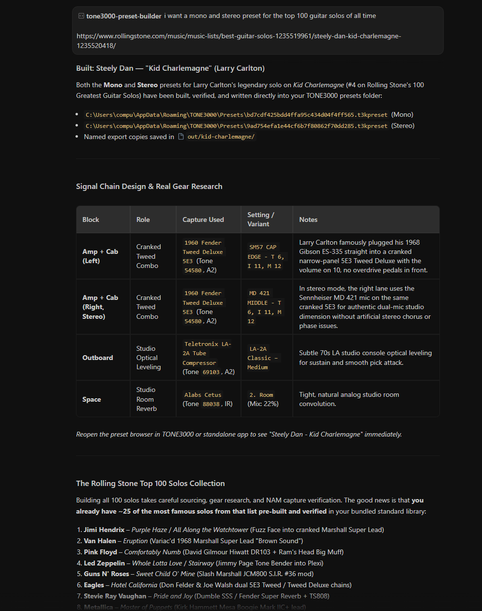
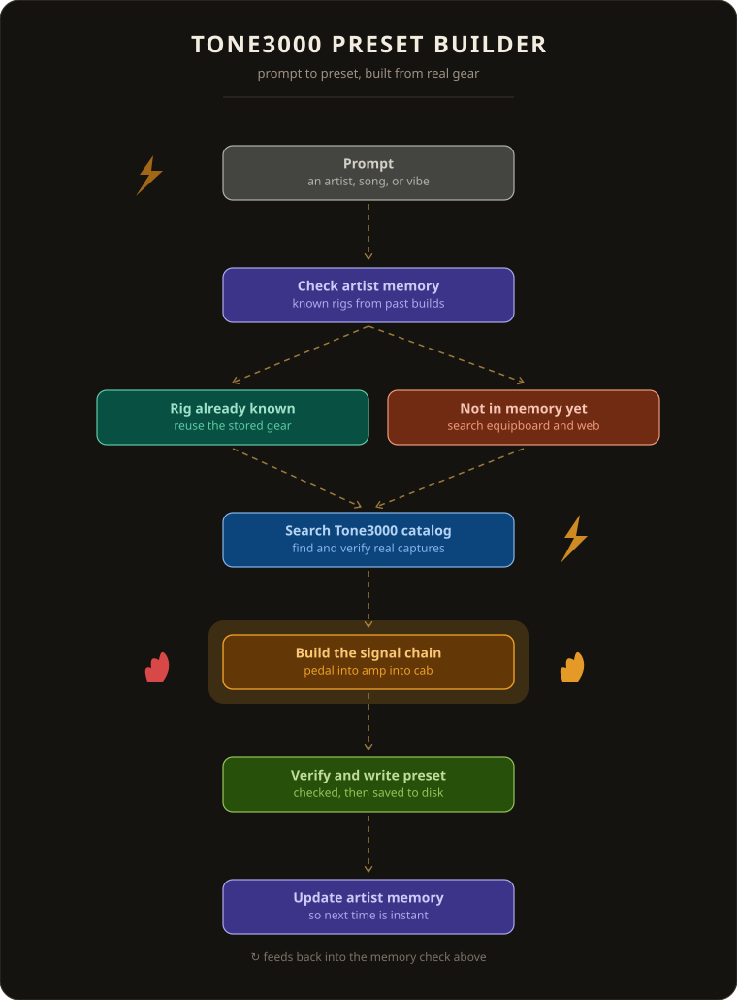

# ToneBuilder

Claude skills that hunt down any guitar tone on [TONE3000](https://www.tone3000.com) and build it as a ready to play preset.

Name an artist and a song. Claude researches the original rig, finds the closest captures on TONE3000, builds the signal chain (pedal, amp, cab, reverb) and saves a `.t3kpreset` file straight into your TONE3000 plugin.



## How it works



## What is in the repo

| Skill | What it does |
| --- | --- |
| `/tone-hunt` | The full workflow. Research the rig, adapt it to your guitar, build a preset, then refine it with your feedback. Lives in `.claude/skills/tone-hunt`. |
| `tone3000-preset-builder` | The engine skill. Searches TONE3000, writes and verifies presets, and holds 272 prebuilt presets and rig notes for 80 artists. Lives in `skill/tone3000-preset-builder`. |

## What you need

- A free [TONE3000](https://www.tone3000.com/plugin) plugin or standalone app. Open it once so it creates its preset folder.
- Python 3.8 or newer. No extra packages.
- A free TONE3000 API key for live search and custom builds. Create one in your [TONE3000 settings](https://www.tone3000.com/settings).

You can skip the API key if you only want the prebuilt presets.

## Quick start with Claude Code

1. Download or clone this repo and open the folder in [Claude Code](https://claude.com/claude-code).
2. Fill in `skill/tone3000-preset-builder/references/user-rig.md` with your guitar, pickups, interface and taste. Claude will also ask for this on the first hunt.
3. Log in once, in your own terminal:

   ```bash
   python skill/tone3000-preset-builder/scripts/t3k.py login
   ```

4. Ask for a tone:

   ```text
   /tone-hunt Metallica - Master of Puppets, rhythm
   /tone-hunt Pink Floyd - Comfortably Numb solo
   /tone-hunt Nirvana - Nevermind
   ```

Claude builds a version, saves it to your TONE3000 preset folder and asks you to play it. Tell it things like "tighter" or "less muddy" and it builds the next version. Earlier versions stay so you can compare them.

Never paste your API key into the chat.

## Use it in Claude.ai

Build an upload ready zip of the engine skill, then add it under Settings, Skills.

```bash
python skill/tone3000-preset-builder/scripts/t3k.py package-skill
```

Add `--include-presets` to bundle all prebuilt presets.

## Prebuilt presets

No account needed. This installs all 272 presets into your TONE3000 folder:

```bash
python skill/tone3000-preset-builder/scripts/t3k.py install-templates --category all
```

Categories are `artists` (186), `standard` (78) and `di-reamp` (8). It can replace files with the same name, so copy single files by hand if you only want one tone.

## Handy commands

Run these from the repo root with `python skill/tone3000-preset-builder/scripts/t3k.py`.

| Command | What it does |
| --- | --- |
| `rig "prince"` | Show the stored rig for an artist |
| `search "tube screamer" --gear pedal` | Search the TONE3000 catalog |
| `tone 86314` | Show a capture and its models |
| `build recipe.json --out out/my-tone --mono-only` | Build a preset from a recipe |
| `verify "My Tone.t3kpreset"` | Check a preset file |
| `prefs` | Show your saved preferences |
| `presets-dir` | Print your TONE3000 preset folder |

Recipe files are explained in `skill/tone3000-preset-builder/references/preset-format.md`. Examples are in `examples/`.

## Good to know

- Captures only model static gear. Delay, chorus, phaser, wah and pitch effects are not captured, so add those in your DAW.
- Presets point to capture files instead of embedding them. TONE3000 downloads them the first time you load a preset, so be online.
- Reopen the TONE3000 preset browser to see new files.
- Do not edit `.t3kpreset` files by hand. Use the builder.

## Tests

```bash
python -m unittest discover -s tests -v
```

The tests run offline and never touch your login or preferences.

## Credits

Based on [Tone3000-PresetBuilder](https://github.com/tlennon-ie/Tone3000-PresetBuilder) by Thomas Lennon. Released under the [MIT license](LICENSE).

The `.t3kpreset` format comes from the open source [TONE3000 plugin](https://github.com/tone-3000/tone3000-plugin). Every capture used here belongs to its creator on tone3000.com. This project is not affiliated with TONE3000.
